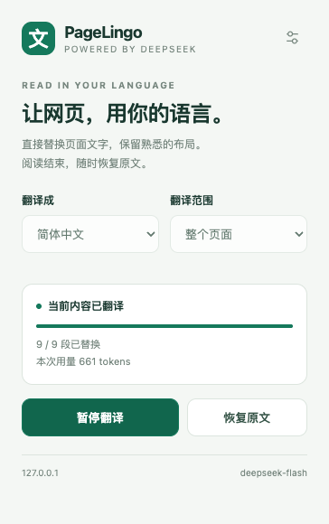
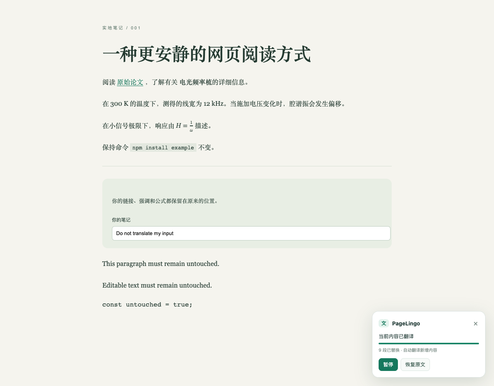

# PageLingo — DeepSeek Translate

A Chrome extension that translates web pages in place using your own DeepSeek API key. It keeps the existing page structure, including links and inline formatting, and lets you restore the original text with one click.

[MIT License](LICENSE) · [中文安装指南](INSTALL.html) · [Implementation notes](PLAN.md) · [Testing](TESTING.md) · [Changelog](CHANGELOG.md)

**Version 0.2.0:** article-first scheduling, smaller opening requests, numbered text fragments and automatic repair of individual failed paragraphs. Reload the extension and refresh existing web pages after updating.



## Install

**Requirements:** Chrome 110 or newer and a DeepSeek API key. The extension does not require Node.js, a build step or a separate application server.

1. Download this repository with **Code → Download ZIP** and extract it, or clone it:

   ```bash
   git clone https://github.com/junyinzh/Chrome_translate_deepseek.git
   ```

2. Open `chrome://extensions` in Chrome and enable **Developer mode**.
3. Click **Load unpacked** and select the extracted or cloned folder containing `manifest.json`.
4. Pin **PageLingo — DeepSeek Translate** from Chrome's extensions menu.
5. Open PageLingo, click the settings button, enter your DeepSeek API key, and select **保存设置**. You can check it with **测试连接**.
6. Visit an ordinary web page and select **翻译网页** in the popup.

API keys are supplied by each user; none is included in this repository. Translation requests use your DeepSeek API balance.

## Use

| Control | What it does |
| --- | --- |
| **翻译网页** | Translate the current page into the selected language |
| **暂停翻译** | Cancel pending requests and keep completed translations visible |
| **继续翻译** | Resume pending work |
| **恢复原文** | Restore the original text |
| **整个页面** | Translate rendered text in the loaded document, including text below the fold |
| **当前可见内容** | Translate the viewport, discovering more text as you scroll |

Closing the popup does not stop translation. A small panel in the lower-right corner of the page provides pause and restore controls. Refreshing the page also returns to the original content.

The interface is currently in Chinese. Translation targets include Simplified Chinese, Traditional Chinese, English, German, French, Japanese and Spanish.

## Features

- In-place translation with one-click restoration.
- Paragraph-level context across inline text fragments.
- Article text before navigation and sidebars, with the title and opening paragraph in a small first request when visible.
- Preservation of existing link and emphasis elements and their event listeners.
- Whole-page and viewport translation modes.
- Optional translation of dynamically inserted or updated text.
- Pause, resume, cancellation and retry of failed paragraphs.
- Independent paragraph validation, immediate delivery of valid/cached results and automatic repair of malformed results.
- Persistent translation cache to avoid repeated API calls.
- Configurable concurrency, progress display and token counts.
- A terminology glossary for consistent technical translations.
- Exclusion of inputs, editable regions, code, formulas, hidden content and `translate="no"` regions.

The default model is `deepseek-flash`. `deepseek-v4-pro` is also available in settings. Both are called with thinking disabled.



## How it works

The popup activates a content script for the current tab. The script collects eligible text nodes, groups their fragments into paragraphs, and prioritizes visible article text over navigation and sidebars. It starts with at most two units in one request; subsequent requests use up to four units, with smaller batches for visible body text. Queue positions are updated as the page reflows or the reader scrolls.

Each fragment has an explicit numeric key, so hyperlinks and punctuation have a stable correspondence. The worker validates each paragraph independently and delivers valid results while repairing failed neighbors. A failed paragraph is retried alone, then in groups of at most eight fragments with full-paragraph context. Cached paragraphs are delivered before the remaining network work finishes. Requests still need a complete, validated JSON response; partial tokens are not inserted into the page.

This favors time to readable article text. Smaller requests and repair attempts can increase request count and prompt-token overhead; they do not guarantee faster completion of the entire page. Current-viewport mode rescans after translations shorten the layout and expose more text.

Translations are written into existing text nodes. The extension retains original text and restores it only when a node still contains its last expected value, so independent site updates are not overwritten with stale text.

The production manifest requests `activeTab`, `scripting` and `storage`, plus access to `https://api.deepseek.com/*`. The API key stays in extension-local settings; requests go directly to DeepSeek. Source text and the page title are included in translation requests. There is no application server or analytics service.

## Limitations

- Supports ordinary HTML pages. Chrome internal pages, the Chrome Web Store and the built-in PDF viewer are outside this workflow.
- PDF translation, OCR and text inside images are not implemented.
- Only the top-level document is processed. Nested frames and shadow-root content are not traversed.
- A sentence split across many inline elements can constrain natural word order because links and formatting stay in their original positions.
- Highly interactive sites may need dedicated compatibility work. Hidden text revealed only by an attribute or CSS change is discovered on the next scan or manual restart.
- Whole-page mode processes the currently loaded DOM; it does not fetch unloaded pages or automatically scroll the website.

## Update a local installation

Pull or download the updated files, click the extension's reload button on `chrome://extensions`, and refresh the web page you want to translate. Unpacked extension updates are manual. Version 0.2.0 keeps existing settings and uses a new cache version automatically; clearing the cache or entering the key again is unnecessary.

## Development

Node.js 20 or newer is needed only for development and tests. The shipped extension has no runtime npm dependencies.

```bash
npm ci
npm test
npx playwright install chromium
npm run test:browser
```

Browser tests run in a temporary Chromium profile against a local HTML fixture. They use a mock provider by default and require no API key. The temporary test manifest grants access to localhost; the production manifest is unchanged.

To run real API checks, set `DEEPSEEK_API_KEY` in your local environment or copy `local-config.example.json` to the ignored `local-config.json` and fill in your key:

```bash
npm run test:live
npm run test:browser:live
npm run test:wikipedia:live
```

The Wikipedia test opens the live St. Moritz article in a temporary profile, translates its viewport, measures time to the first translated lead, and checks exact restoration and link identity. It requires external access and is not run in CI. The optional local configuration file also provides first-install settings when loading the extension. It is not required when configuring through the options page. An existing installation retains its saved settings; edit them through the options page.

Reports and screenshots are generated in the ignored `test-results/` directory. Before publishing changes, run `npm run check:release` to check indexed files for local configuration and API keys. `node scripts/check-release.mjs --history` additionally checks reachable Git history.

## Project files

| File | Purpose |
| --- | --- |
| `manifest.json` | Manifest V3, permissions and entry points |
| `background.js` | API calls, cache, retries and cancellation |
| `content.js` | Text discovery, replacement, restore and floating controls |
| `lib/` | Settings and provider request/response handling |
| `popup.*`, `options.*`, `ui.css` | Popup and settings interface |
| `tests/`, `scripts/` | Verification and development helpers |
| `local-config.example.json` | Optional configuration template with an empty key |

## Contributing

Issues and focused pull requests are welcome. For website compatibility problems, include the page URL, expected behavior and a minimal example where possible. Run the unit and browser tests before submitting code changes. Live API tests are optional and consume API credits.

## License

[MIT](LICENSE) — Copyright (c) 2026 junyinzh.

## References

- [Chrome content scripts](https://developer.chrome.com/docs/extensions/develop/concepts/content-scripts)
- [Chrome activeTab permission](https://developer.chrome.com/docs/extensions/develop/concepts/activeTab)
- [Chrome extension network requests](https://developer.chrome.com/docs/extensions/develop/concepts/network-requests)
- [Chrome local installation](https://developer.chrome.com/docs/extensions/get-started/tutorial/hello-world#load-unpacked)
- [DeepSeek Chat Completions API](https://api-docs.deepseek.com/api/create-chat-completion/)
